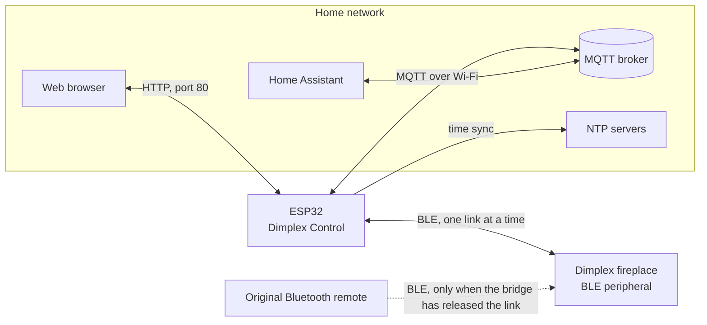
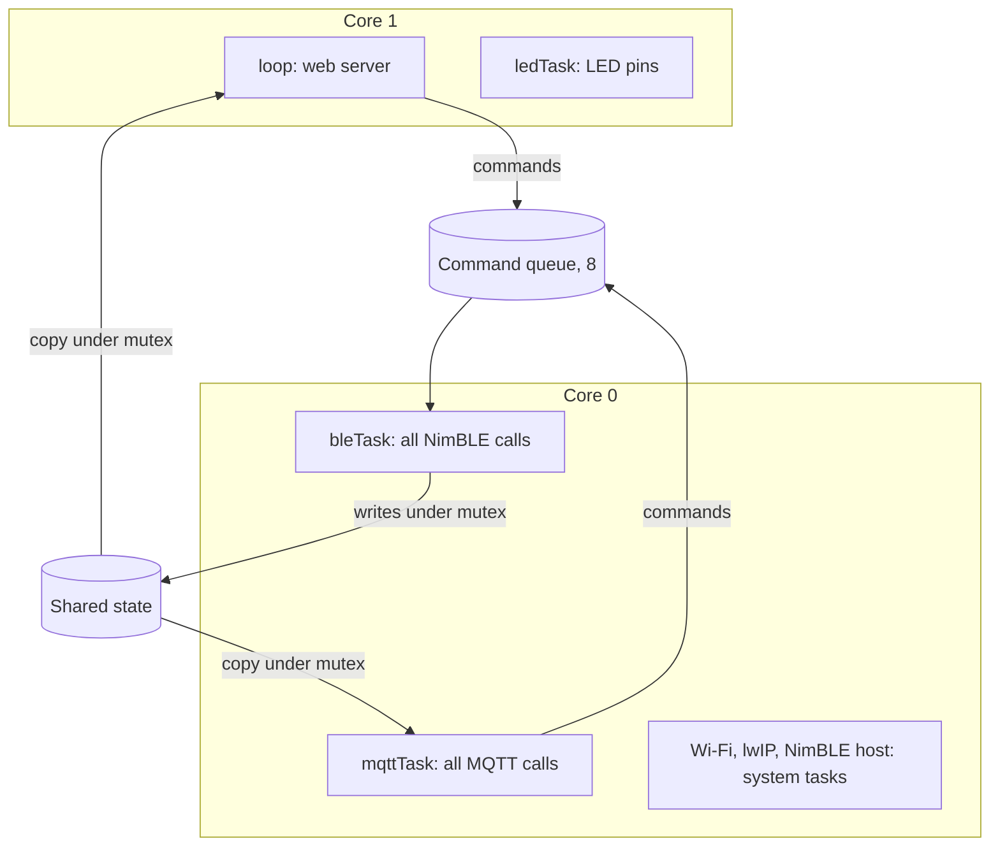
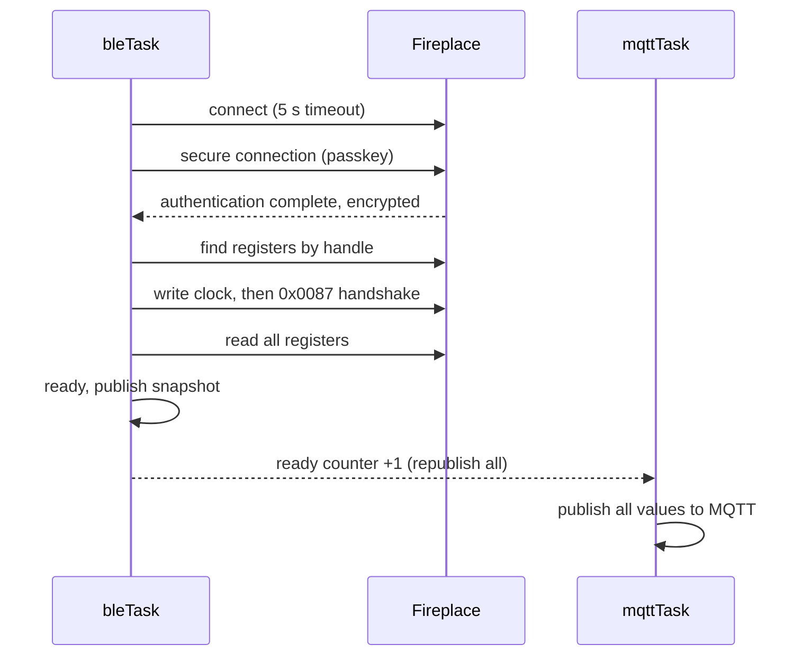
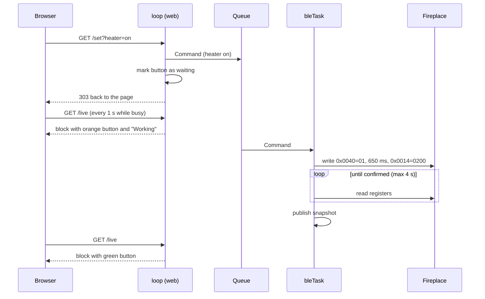

# Dimplex Control: design document

This document describes how Dimplex Control is built and why: what it talks to, how the program is organised, how the main flows work and which design decisions were made. It describes the current state of `Dimplex-Control.ino`.

Related documents:

| Document | Contents |
|---|---|
| `README.md` | Introduction, requirements, getting started |
| `register-map.md` | The fireplace's Bluetooth registers, with confidence levels |
| `experiments.md` | How the registers were found, measurements, open questions |
| `task-architecture.md` | The review and specification that led to the task layout (history; this document is the current description) |
| `CHANGES.md` | Change list per version |

---

## 1. Purpose and scope

### Purpose
Dimplex Control is an ESP32 bridge for a **Dimplex Opti-myst electric fireplace** (built and tested on the Engine 56/600). The fireplace is normally controlled by a Bluetooth remote. The bridge takes over that job and makes the fireplace available through:

- a **web interface** on the local network, and
- **MQTT** with Home Assistant auto-discovery.

### Goals
1. Control everything the remote can do: flame effect, flame level, heater on/off, setpoint, heater power.
2. Show the state the fireplace reports, also when it was changed with the remote.
3. Stay responsive: a slow broker, a fireplace out of range or a running command must not freeze the web page.
4. Be configurable without re-flashing (Wi-Fi, MQTT broker, fireplace address and passkey).
5. Coexist with the original remote: the Bluetooth link can be released on demand.
6. Be easy to follow and change: one sketch file with clear sections, English names and comments.

### Non-goals
- No cloud connection. Everything stays on the local network.
- No support for several fireplaces per bridge.
- No authentication on the web interface (see section 9).
- No replacement for the fireplace's own safety functions. The fireplace remains in charge of heating.

---

## 2. System context



The ESP32 is the only component that talks to the fireplace. Home Assistant never talks to the fireplace or the ESP32 directly. It uses the MQTT broker.

**The one-link constraint.** The fireplace accepts one Bluetooth connection at a time. While the bridge holds the link, the original remote cannot connect, and while the remote holds it, the bridge cannot connect. A switch on the web page and in MQTT ("Bluetooth link") releases or retakes the link.

---

## 3. External interfaces

### 3.1 Bluetooth Low Energy (fireplace)

| Aspect | Design |
|---|---|
| Role | The ESP32 is the BLE **central** (client), the fireplace is the peripheral (server). Library: NimBLE-Arduino 2.x. |
| Finding the fireplace | Priority: (1) the address pinned in the settings, (2) the address remembered from an earlier auto-detect, (3) a 4 s active scan for a device whose name contains `Dimplex` (they advertise as `FI####<Dimplex>`). A found address is remembered in flash. In auto mode a failed connect clears the remembered address, so the next attempt scans again. |
| Security | Legacy pairing with a fixed 6-digit passkey (default `064259` for the author's unit). The ESP32 declares keyboard and display capability and injects the configured passkey when the fireplace asks for it. No bonding is stored. Pairing takes place on every new connection. |
| Connect procedure | Connect with a 5 s timeout, then secure the connection (pairing). The connection is "ready" once pairing succeeded and the registers were found. |
| Registers | Addressed by raw GATT handle (the fireplace has no useful UUID names): `0x0040` control, `0x0014` heater, `0x0018` setpoint, `0x0048` heater power, `0x0042` flame level, `0x0055` temperature, `0x001e` setpoint limits, `0x0012` clock, `0x0087` handshake, `0x0076` volume, `0x003c` / `0x0063` diagnostics. Meaning and confidence of each: `register-map.md`. |
| Handshake after connecting | Write the clock (`0x0012`) with the real local time, then write `0x0087` = `010100`, 120 ms later `000000`, as the remote does. If NTP has no time yet, the clock write is retried every 2 s. |
| Reading | `readFireplaceState()` reads the registers one by one. It runs every 5 s and after every command. |
| Writing | One write per register, with response. The heater is started with two writes 650 ms apart (`0x0040`=`01`, then `0x0014`=`0200`), as the remote does. |
| Confirmation | After a write the registers are read back until the fireplace reports the new state (first read after 250 ms, then every 300 ms, at most 3 to 4 s). The log shows `state confirmed after N ms` or `NOT confirmed`. |
| Release | `bleReleaseLink()` disconnects and prevents reconnecting until `bleResumeLink()` is called. |

### 3.2 Wi-Fi and the local network

| Aspect | Design |
|---|---|
| Wi-Fi setup | WiFiManager. With no saved network, or when connecting fails, the ESP32 opens an access point `Dimplex-Setup` (password `dimplex123`) with a captive portal. The portal times out after 180 s. |
| Portal fields | MQTT host, port, user and password; fireplace address (with a list from a BLE scan to pick from) and passkey. |
| Name | The hostname, mDNS name, MQTT client id and Bluetooth device name are all `dimplex-control` (`http://dimplex-control.local/`). |
| Time | NTP (`pool.ntp.org`, `time.google.com`) with a time zone string that is fixed in `loop()` (default Central European Time with daylight saving). The time is used for the fireplace clock and for the time column of the CSV log. |
| mDNS client | If the broker is given as `something.local`, it is resolved with an mDNS query (2 s timeout) in the MQTT task. |

### 3.3 MQTT

**Connection.** Client id `dimplex-control`, user and password from the settings, port from the settings. Last will: `dimplex/status` = `offline` (retained). On connect: `dimplex/status` = `online` (retained), subscribe to the command topics, publish discovery and republish all state.

**Command topics (subscribed):**

| Topic | Payload | Effect |
|---|---|---|
| `dimplex/power/set` | `ON` / `OFF` | Flame effect on; `OFF` switches everything off, the heater included |
| `dimplex/heater/set` | `ON` / `OFF` | Heater on (only works while the flame effect is on) or off |
| `dimplex/setpoint/set` | degrees, e.g. `21` | Setpoint, rounded and clamped to the limits. Mode "Fireplace thermostat": the fireplace's setpoint, only while the heater is on. Bridge modes: the bridge's own setpoint, at any time |
| `dimplex/level/set` | `1` to `6` | Flame level |
| `dimplex/ble/set` | `ON` / `OFF` | `ON` = bridge holds the Bluetooth link; `OFF` = release it for the remote |
| `dimplex/room_temperature/set` | degrees, e.g. `21.3` | Room temperature for the control mode "Room sensor (MQTT)". Plain number only; anything else is ignored. Publish without retain. Subscribed in every mode, only used in that mode |

**State topics (published, retained):**

| Topic | Values | Notes |
|---|---|---|
| `dimplex/power/state` | `ON` / `OFF` | Flame effect |
| `dimplex/heater/state` | `ON` / `OFF` | In a bridge mode: the user's wish for heating, not the momentary state of the element (so it stays `ON` while the target is reached) |
| `dimplex/setpoint/state` | degrees or `None` | Mode "Fireplace thermostat": `None` (unknown in Home Assistant) while the heater is off or before the first reading. Bridge modes: always the bridge setpoint |
| `dimplex/level/state` | `1` to `6` | |
| `dimplex/heater_power/state` | `low` / `high` / `raw xx` | |
| `dimplex/temperature/state` | e.g. `21.5` or `None` | Internal sensor, published only when it changed by at least 0.2 °C (deadband) |
| `dimplex/control_mode/state` | text | Selected temperature control: `Fireplace thermostat`, `Room sensor (MQTT)`, `Internal sensor` (retained). Changed on the web page only |
| `dimplex/thermostat/state` | text | `heating`, `target reached`, `no room temperature`, `off`, `not used` (retained) |
| `dimplex/ble/state` | `ON` / `OFF` | Also published while the link is released |
| `dimplex/raw/state` | text | Raw register values for diagnostics |
| `dimplex/diag/state` | JSON | Health values (restart reason, uptime, memory, signal, counters); published after connecting and then every 60 s |
| `dimplex/status` | `online` / `offline` | Availability (last will) |

**Home Assistant discovery.** Config topics are `homeassistant/<component>/dimplex/<objectId>/config`. All entities belong to one device (`dimplex_control`, name "Dimplex Control", model "Opti-myst"):

| Entity | Type | Unique id |
|---|---|---|
| Fireplace | switch | `dimplex_power` |
| Heater | switch | `dimplex_heater_switch` |
| Setpoint | number (15 to 30) | `dimplex_setpoint_number` |
| Flame intensity | number (1 to 6) | `dimplex_level` |
| Bluetooth link | switch (config) | `dimplex_ble_link` |
| Flame intensity state | sensor | `dimplex_levelstate` |
| Heater power | sensor | `dimplex_heater_power` |
| Internal temperature | sensor | `dimplex_temperature` |
| Temperature control | sensor | `dimplex_control_mode` |
| Thermostat status | sensor | `dimplex_thermostat` |
| Raw registers | sensor (diagnostic) | `dimplex_raw` |
| Last restart reason, Restart count, Uptime, Free memory, Lowest free memory, Wi-Fi signal, Wi-Fi drops, Last Wi-Fi outage, Bluetooth connections, MQTT connect failures, Free stack BLE task, Free stack MQTT task | sensors (diagnostic), all read from `dimplex/diag/state` | `dimplex_diag_restart_reason`, `dimplex_diag_restart_count`, `dimplex_diag_uptime`, `dimplex_diag_free_heap`, `dimplex_diag_min_heap`, `dimplex_diag_wifi`, `dimplex_diag_wifi_drops`, `dimplex_diag_wifi_outage`, `dimplex_diag_ble_connects`, `dimplex_diag_mqtt_failures`, `dimplex_diag_stack_ble`, `dimplex_diag_stack_mqtt` |

Entities that existed in older versions (water sensor, volume, the read-only heater and setpoint sensors) are removed on connect by publishing an empty retained config.

**Immediate echo.** A command takes about a second on the fireplace. Home Assistant switches flip back when the state topic does not change quickly. When a command arrives from MQTT, the expected state is published at once, and older values of the controlled entities are held back until the command has finished (or 8 s). If the command failed, the real state follows after the hold. Details: section 6.4.

### 3.4 HTTP (web interface)

Served by the Arduino `WebServer` on port 80 from `loop()`.

| Path | Purpose |
|---|---|
| `/` | Main page: Bluetooth link, flame effect, heater, setpoint, temperature control mode, thermostat status, room temperature (room sensor mode), internal temperature |
| `/settings` | Settings page: flame level, heater power, volume, fireplace selection (scan, address, passkey), margins and time-out of the temperature control, factory reset |
| `/debug` | Debug page: raw registers, temperature history, CSV download, system information, restart |
| `/live?p=<page>` | Only the live block of a page (HTML fragment); polled by the page script |
| `/set?...` | Actions. Parameters: `ctl=fireplace/room/internal` (temperature control mode), `xoff`, `xon`, `ioff`, `ion` (margins in degrees) with `tmo` (time-out in minutes), `ble=on/off`, `fx=on/off`, `heater=on/off`, `hpwr=low/high`, `sp=<deg>`, `spd=<+/-1>`, `flame=1..6`, `vol=0..6`, `scan=1`, `fpaddr=<mac or auto>`, `pkey=<digits>`, `diag=reset`, `restart=1`, `factory=confirm`, plus `r=<page>` for the page to return to |
| `/reset` | Confirmation page for the factory reset |
| `/csv`, `/csv?download=1` | Status log as text or as a file (`dimplex-status-log.csv`) |
| `/manifest.webmanifest`, `/sw.js`, `/icon-192.png`, `/icon-512.png` | Web app manifest, service worker and icons, so the page can be installed as an app (below) |
| `/log` | The restart-proof log as text: the previous session (with its last steps) and the latest lines of this one |

Every page is a fixed frame around one live block. A small script fetches `/live?p=<page>` every 3 s (every 1 s while commands are running or the link is connecting) and replaces the block. Forms sit outside the live block, so a refresh never clears what is being typed. Without JavaScript the page refreshes itself every 5 s.

`/set` only parses the request, puts commands in the queue and answers `303` back to the page. The result appears in the live block once the BLE task has finished. Buttons show the progress: green is on (or the selected value), red is off, orange means the request has been sent and the fireplace has not confirmed it yet, grey is not selected.

**Install as an app.** Every full page links a web app manifest (`/manifest.webmanifest`: name, short name, start URL, `standalone` display, theme colour, 192 and 512 px icons, also marked maskable), the Apple tags (`apple-mobile-web-app-capable`, title, status bar style, `apple-touch-icon`) and registers a service worker (`/sw.js`). The service worker only exists to satisfy Chrome's installability check: it has an empty fetch handler and caches nothing, so the page always shows live data. The icons (an orange square with a white flame, full bleed so they also work as maskable icons) are PNG arrays in `icons.h`, about 7 kB in flash. Files that never change are sent with `Cache-Control: max-age=86400`.

What works where, checked with Chromium's installability check:
- **iPhone (Safari, and Chrome on iOS 16.4 and newer):** "Add to Home Screen" works over plain HTTP, and the page then opens full screen.
- **Android (Chrome):** "Install app" needs a secure origin. Over plain HTTP the browser reports `not-from-secure-origin` and no service worker can register (the page script checks for this and does nothing). With HTTPS, or with the Chrome flag *Insecure origins treated as secure* set for the bridge's address, the manifest, icons and service worker pass the check. The bridge itself does not serve HTTPS: a self-signed certificate is not accepted for installing, and a trusted one cannot be issued for a `.local` name. A reverse proxy with a real certificate (for example in Home Assistant) is the clean solution. See the README for the steps.
- The app is only a window on the web page: it needs the local network and has no offline mode.

### 3.5 Serial log

115200 baud. Every line is `[<ms since boot> ms] [<tag>] <message>`, written by the helper `logLine(tag, format, ...)`. The line is built first and written in one piece so output of different tasks does not mix. Tags: `boot`, `cfg`, `wifi`, `mdns`, `mqtt`, `pub`, `ble`, `sec`, `web`.

### 3.6 Status LEDs

The combined LED (GPIO 2) shows the weakest link:

| Pattern | Meaning |
|---|---|
| fast blink | setup portal open |
| 1 flash + pause | no Wi-Fi |
| 2 flashes + pause | Wi-Fi ok, no MQTT |
| 3 flashes + pause | Wi-Fi and MQTT ok, no Bluetooth link |
| slow blink (1 s) | everything ok, Bluetooth released for the remote |
| steady on | everything connected |

Optional: one external LED each for Wi-Fi, MQTT and Bluetooth (pins in the settings; on = connected, blinking = trying, off = down or released).

### 3.7 Flash storage (NVS)

Namespace `cfg`:

| Key | Contents |
|---|---|
| `host`, `port`, `user`, `pass` | MQTT broker settings |
| `addr` | Pinned fireplace address (empty = auto-detect) |
| `pkey` | Pairing passkey as text |
| `detaddr` | Address found by the last auto-detect |
| `boots` | Number of starts (restart count) |
| `ctlmode` | Temperature control mode (0 fireplace, 1 room sensor, 2 internal sensor) |
| `bsetp` | Setpoint of the bridge's control (15 to 30) |
| `xoff`, `xon`, `ioff`, `ion` | Margins in tenths of a degree: room sensor off / on, internal sensor off / on |
| `tmo` | Room temperature time-out in minutes |

The Wi-Fi credentials are stored by WiFiManager itself. A factory reset clears this namespace (temperature control settings included) and the Wi-Fi credentials, then restarts into the setup portal.

---

## 4. Program structure

### 4.1 Layout of the sketch

One file, `Dimplex-Control.ino`, in numbered sections:

| Section | Contents |
|---|---|
| Header | What it does, task layout, LED codes, libraries |
| 1. Settings | LED pins, fireplace identity, MQTT defaults, timing constants, MQTT topics, global objects |
| 2. Shared data | Command types, `SharedState`, the queue and the snapshot functions |
| Logging and diagnostics | `logLine()` (with the restart-proof ring), restart reason, previous session, `restartDevice()` |
| 3. BLE state | Private variables of the BLE task |
| 4. Settings in flash | Load, save, passkey conversion |
| 5. BLE | Callbacks, handshake, connect, register reading, control commands, scan, settings apply, factory reset, `bleTask` |
| 6. MQTT | Discovery, incoming messages, echo, connect with backoff, `publishChanges()`, `mqttTask` |
| 7. Web pages | Page builders, button helpers, handlers |
| 8. LEDs | `ledTask` |
| 9. Setup | Setup portal, `setup()`, `loop()` |

Two more files in the same folder: `icons.h` holds the app icons as PNG byte arrays, and `thermostat.h` holds the types and the decision logic of the temperature control (section 5.5). `thermostat.h` is plain C++ without Arduino calls, so `test/thermostat_test.cpp` can test it on a PC.

All types (`struct`, `enum`) are defined above the first function. The Arduino IDE inserts automatic function prototypes before the first function, so a type defined after it breaks the build with errors like "does not name a type".

### 4.2 Tasks



| Task | Core | Priority | Stack | Owns |
|---|---|---|---|---|
| `loop()` | 1 | 1 | default | `WebServer`, NTP and mDNS start, button feedback table |
| `bleTask` | 0 | 1 | 8192 | All NimBLE calls, BLE state, the command execution |
| `mqttTask` | 0 | 1 | 8192 | `WiFiClient`, `PubSubClient`, broker lookup, published-values table |
| `ledTask` | 1 | 1 | 2048 | The LED pins (reads a few `volatile` flags) |

Wi-Fi, lwIP and the NimBLE host run as system tasks, mostly on core 0.

**Ownership rules** (these keep the design simple and thread safe):
1. Only `bleTask` calls NimBLE. NimBLE allows one GATT operation per connection, and BLE actions take seconds, so a mutex would not help. One owner plus a queue does.
2. Only `mqttTask` calls PubSubClient. It is not thread safe.
3. `loop()` never calls BLE or MQTT. It reads a snapshot and puts commands in the queue.
4. No task waits on another task while holding the mutex. The mutex is only held while copying data, never during a BLE or network call.
5. Every task loop yields (`vTaskDelay`, a queue wait or `delay`), so the idle task and the watchdog get CPU time.

### 4.3 Data flow

**Commands** (web or MQTT to the BLE task) go through a FreeRTOS queue of 8 entries:

```cpp
struct Command { CommandType type; int16_t argument; CommandSource source; };
```

Command types: flame effect, heater, heater power, setpoint, setpoint delta (the +/- buttons), flame level, volume, Bluetooth release, Bluetooth resume, scan, apply settings, factory reset. Sending never blocks (`xQueueSend` with timeout 0); a full queue is reported as "Busy" and counted. The BLE task executes commands one at a time, in order. The +/- setpoint buttons send a delta that is applied to the value at execution time, so two quick clicks add up.

**State** (BLE task to web and MQTT) goes through one `SharedState` structure under one mutex:
- The BLE task keeps its own private variables. After every change (command, poll, link change) `publishSnapshot()` copies them into `g_shared` under the mutex and increments a version counter.
- Readers (`loop()` and `mqttTask`) copy `g_shared` into a private snapshot under the mutex and then work from the copy. A page or a publication can therefore never mix two states.
- `SharedState` holds plain data only (no `String`), so it can be copied with `memcpy`. It contains the link flags, the registers, the setpoint and limits, the scan result, the last result message, the status history (120 rows) and the temperature minimum and maximum.
- Single flags that the NimBLE callbacks set from the host task (`g_bleConnected`, `g_blePaired`, `g_bleReady`, `g_bleEnabled`, ...) are `volatile` (single aligned writes).

**Counters** `g_commandsQueued` and `g_commandsCompleted` (atomic) let the MQTT task know when a command has finished, for the echo hold (6.4).

### 4.4 Timing constants

| Constant | Value | Meaning |
|---|---|---|
| `FIREPLACE_POLL_INTERVAL_MS` | 5000 | Register polling |
| `THERMOSTAT_INTERVAL_MS` | 1000 | How often `bleTask` runs the thermostat (it only switches when the decision changes) |
| room temperature time-out | 15 min (1 to 240, setting) | Fail-safe of the room sensor mode |
| thermostat retry | 30 s | After a heater switch that was not confirmed; the setpoint sync retries every 15 s |
| `BLE_RETRY_INTERVAL_MS` | 5000 | Pause between connect attempts |
| connect timeout | 5000 | One BLE connect attempt |
| scan duration | 4000 | One BLE scan |
| read-back | 250 ms + 300 ms steps, 3 to 4 s max (volume 2 s) | After each write |
| `MESSAGE_SHOW_TIME_MS` | 8000 | How long a result message stays on the page |
| `PAGE_REFRESH_MS` / `PAGE_REFRESH_BUSY_MS` | 3000 / 1000 | Live block refresh |
| MQTT backoff | 3 s doubling to 30 s | After a failed connect; after 3 failures the broker is looked up again |
| MQTT socket timeout | 3 s | So a silent broker does not hold the task |
| temperature deadband | 0.2 °C | MQTT publication of the temperature |
| echo hold | until the command is done, at most 8 s | MQTT echo |
| button feedback | settle 2 s, give up 15 s | Orange buttons on the web page |
| Wi-Fi watchdog | 30 s / 5 min / 10 min | New connection request (repeated every 30 s) / start again with the saved network / restart (`WIFI_RECONNECT_AFTER_MS`, `WIFI_FULL_RECONNECT_AFTER_MS`, `WIFI_RESTART_AFTER_MS`) |
| status history | on change, otherwise once a minute, 120 rows | CSV log |

### 4.5 Memory

Three copies of `SharedState` (the shared one plus one snapshot each for web and MQTT, about 5 kB each), two task stacks of 8 kB and one of 2 kB are the main static allocations. The Debug page shows the free stack of the BLE and MQTT tasks and the free heap, so the stack sizes (an estimate) can be checked on real hardware.

### 4.6 Crash diagnostics

The bridge usually sits somewhere without a USB cable, so after a crash or reset it has to explain itself.

| Part | What it does |
|---|---|
| Restart reason | At boot `esp_reset_reason()` is turned into text: power on, external reset, software restart, crash (panic), interrupt or task watchdog, brownout. A software restart that was asked for by the bridge itself (restart button or factory reset, via `restartDevice()`) is reported as such, so it is not mistaken for a crash. |
| Restart count | A counter in flash (`boots`), incremented at every start. |
| Restart-proof log | Every `logLine()` line is also stored in a ring of the last 30 lines in RTC memory (`RTC_NOINIT_ATTR`). That memory keeps its content over a crash, a watchdog reset and a software restart, but not over a power loss. A magic number at the start and the end of the structure tells whether the content is valid. A mutex protects the ring because several tasks write log lines. |
| Last steps | Each task writes what it is doing now into RTC memory (`setBleStep`, `setMqttStep`, `setWebStep`): "connecting to the fireplace", "command: heater (1)", "publishing discovery", "page: debug" and so on. After a crash this shows in which step the task was, also when that step logged nothing yet. |
| Previous session | At the start of `setup()`, `startDiagnosticsSession()` copies the ring and the steps into normal RAM, decides the restart reason, clears the ring for the new session and counts the start. The Debug page shows reason, count, last steps and the previous log lines; `/log` shows previous and current lines as plain text. |
| Home Assistant | The reason, the count and other health values (uptime, free and lowest free memory, Wi-Fi signal, Wi-Fi drops and the length of the last outage, Bluetooth connections, MQTT failures, free stack of both tasks) are published as diagnostic sensors from one JSON message every 60 s. If the bridge dies, the availability topic turns the sensors to unavailable; after the restart the reason sensor tells why. A restart count that jumps, or an uptime that falls back to zero, is a good trigger for an automation. |

Limits: the ring only holds the last 30 lines (96 characters each), and nothing survives a power loss. A crash in the middle of writing a line can leave that last line incomplete. The log is not a crash dump: the register contents and the backtrace of a panic are not stored (see the reminders in section 11).

---

## 5. Component descriptions

### 5.1 BLE task
Loop, in this order:
1. If Bluetooth is enabled, not connected and 5 s have passed since the last attempt: connect to the fireplace (may take seconds).
2. If connected and paired, but not ready: find the registers, send the handshake, read the state, mark ready, tell the MQTT task to republish everything.
3. If ready and the clock was not set yet: retry the clock write every 2 s (needs NTP time).
4. Wait up to 100 ms for a command; execute it, publish the snapshot. This wait is also the loop's yield.
5. If ready and 5 s have passed: poll and publish the snapshot.
6. If the link state changed (callbacks run in another task): publish the snapshot.

Each control command checks the link first, reads the current state, refuses nonsensical requests with a message (for example "Heater not started: switch the flame effect on first"), writes, then reads back until confirmed.

### 5.2 MQTT task
Loop: without Wi-Fi wait; without a known broker address resolve it; if not connected try to connect with backoff; otherwise run the client loop, release the echo hold when its command is done, republish everything when the BLE link was re-established, and publish every changed value from a fresh snapshot (`publishChanges()`). The task remembers what it published last (`g_published*`), so only changes are sent. A 10 ms delay per pass leaves CPU time for Wi-Fi and BLE.

### 5.3 Web layer (`loop()`)
`loop()` starts NTP, mDNS and the web server once Wi-Fi is up and then only calls `handleClient()`. It records the longest gap between two passes and the longest request, shown on the Debug page as a responsiveness check. Page builders take a snapshot and render from it; no page builder calls BLE or MQTT. The table of pressed buttons (`g_awaited`) lives here: a press marks the requested value, and the table is cleaned up when the state matches, when no command is pending any more, or after 15 s.

### 5.4 LED task
Sets the pins every 50 ms from `WiFi.status()` and a few `volatile` flags. It does not take the mutex.

### 5.5 Temperature control (thermostat)
Issue #1: the fireplace's own thermostat kept the element running above the setpoint (section 11), so the bridge can regulate itself. The decision is in `thermostat.h` (`decideThermostat()`); the switching is in `runThermostat()` in `bleTask`, called once a second while the link is ready. Everything runs in `bleTask`, so the ownership rules (4.2) are unchanged.

**Modes** (`ControlMode`, stored in flash, chosen with `ctl=` on the Main page):

| Mode | Temperature used | Heater switch means |
|---|---|---|
| Fireplace thermostat | none | The element is switched physically, as before. The fireplace regulates. |
| Room sensor (MQTT) | last value on `dimplex/room_temperature/set` | "I want heating" (`g_thermostatWanted`); the bridge switches the element |
| Internal sensor | register `0x0055`, read in the same poll round | the same |

**Hysteresis.** Off when the temperature reaches setpoint + off-margin; on again when it is at or below setpoint - on-margin. The first decision after the user switches on, after a mode change or after a sensor time-out is a *start*: heat while below the setpoint. Defaults: room sensor +0.3 / -0.3 °C, internal sensor +1.0 / -0.2 °C (the internal sensor reads high while heating, see the issue and section 11). Margins are 0 to 5.0 °C with at least 0.2 °C band in total, so the element cannot flutter.

**Fail-safe.** In the room sensor mode, when no valid value has arrived within the time-out (or none since boot), the state is `no room temperature` and the heater is switched off. The wish stays, so a new value restarts the heating without a user action. A rejected MQTT payload (not a number, out of range) does not refresh the timer. If the internal sensor cannot be read for one round, nothing is changed that round.

**Taking over.** A heater found running without a wish (started with the remote, or after a bridge restart) is taken over by the control. The fireplace is switched off, or the Bluetooth link released: the wish is cleared.

**Setpoint.** In a bridge mode the setpoint is the bridge's own (`bsetp`, flash). It is also written to the fireplace after the heater has started (the fireplace starts at 21 every time), so the fireplace's own thermostat acts as a back-up if the bridge fails. A write that is not confirmed is tried again after 15 s. `dimplex/setpoint/state` then always shows the bridge setpoint.

**Switching the element.** A failed or unconfirmed switch is retried after 30 s, not every second.

---

## 6. Key flows

### 6.1 Boot
1. Serial, queue, mutex, LED task (so the LED can blink while the portal is open).
2. Load settings from flash (defaults stay for keys that were never saved).
3. Initialise NimBLE (device name, transmit power, security: passkey entry, no bonding).
4. Register the portal parameters, set the hostname.
5. `runSetupPortal(false)`: connect to the saved Wi-Fi, or open the portal (blocks, at most 180 s). When the portal opens, a BLE scan fills the fireplace list first.
6. Reload settings (the portal may have changed them), publish an initial snapshot.
7. Start `bleTask` and `mqttTask` on core 0.
8. `loop()` starts NTP, mDNS and the web server as soon as Wi-Fi is up.

### 6.2 Connecting to the fireplace



### 6.3 A command from the web page



### 6.4 A command from MQTT, with echo

1. `onMqttMessage()` converts topic and payload into a command and queues it. No BLE in the callback.
2. If it was accepted, the expected state is published at once (for example the heater switch to `ON`). The hold starts: `g_holdUntilCompleted` is set to the number of commands queued so far, with a deadline of 8 s.
3. While the hold lasts, `publishChanges()` skips the controlled entities (power, heater, setpoint, Bluetooth link), so a read that still shows the old state is not published.
4. When `bleTask` has finished the command (counter reached) or the deadline passes, the hold ends and the real state is published. If the fireplace did something else, Home Assistant shows that.

Flame level and heater power are not switches and are not echoed.

### 6.5 Releasing and retaking the Bluetooth link
Release: the BLE task disconnects and sets `g_bleEnabled` to false. It makes no connect attempts until resumed. The LED slow-blinks and `dimplex/ble/state` is `OFF`. Resume: `g_bleEnabled` becomes true and the next connect attempt is made immediately. If the remote still holds the link, the attempts fail every 5 s until it lets go. A release that arrives during a connect attempt can take up to 5 s to take effect because the BLE task is busy.

### 6.6 Changing the fireplace in the web interface
The page stores the new address and passkey in a staging area (under the mutex) and queues "apply settings". The BLE task validates them (address format `00:a0:50:04:75:d9` or empty or `auto`; passkey 1 to 6 digits), saves them in flash, forgets the remembered address, drops the link and reconnects (unless the link was released on purpose). A BLE scan on the Settings page lists fireplaces that are advertising; a fireplace that already has a connection does not advertise and does not show up.

### 6.7 Factory reset
A confirmation page, then the BLE task releases the link, clears the `cfg` namespace and the Wi-Fi credentials and restarts. Without Wi-Fi settings the device opens the `Dimplex-Setup` portal, like after a physical reset.

---

## 7. Design decisions

| Decision | Reason |
|---|---|
| Separate tasks for web, BLE and MQTT | In the first version everything ran in `loop()`. A blocking BLE connect (5 s), an mDNS lookup (2 s) or a slow broker froze the web page. Now only the task that waits is affected. |
| One owner per resource, commands through a queue | NimBLE and PubSubClient are not thread safe. A mutex cannot protect a BLE operation that takes seconds. |
| One snapshot under one mutex, readers copy | Several related fields (registers, setpoint, history) must be consistent. One mutex means no deadlocks, and copying takes microseconds. |
| Plain data in the shared state | A `String` modified by one task while another copies it can corrupt the heap. |
| Read back until confirmed | The fireplace can need over a second to report a new state. A read after a fixed pause sometimes showed the old state and Home Assistant flipped back for a moment. |
| Optimistic echo plus hold for MQTT commands | Home Assistant switches flip back when the state topic does not change quickly. The hold keeps older reads from overwriting the expected state. |
| Registers addressed by handle | The fireplace exposes no useful UUID names, and the handles are stable on the tested firmware. If another firmware numbers them differently, the lookup fails and the control register is reported missing. |
| Polling instead of notifications | Reading every 5 s is simple and enough for temperature and remote changes. Whether the registers support notifications has not been investigated. |
| Setpoint "unknown" while the heater is off | The fireplace only has a setpoint while the heater runs. Showing the last value is misleading. |
| Temperature deadband of 0.2 °C | The sensor jumps by 0.1 to 0.3 °C without any change in conditions and the recorder filled up with noise. The Debug page, CSV and raw topic still show every reading. |
| Volume only on the Settings page | Many models, including the author's, have no sound effect. The register is documented but kept out of MQTT and the CSV. |
| Buttons show "waiting" until confirmed | A command takes about a second. Without feedback it looks as if nothing happened. |
| Timestamps through one helper | A mix of timestamped and plain lines made the log hard to read. |
| Settings in NVS, set up through a captive portal | No credentials in the source needed for normal use, and no re-flash to change the broker or fireplace. |
| Thermostat in the bridge, in `bleTask` | The fireplace's own thermostat is unreliable. The bridge already owns the BLE link, so the control needs no new task and no new locking. |
| Decision logic in `thermostat.h` | It has no hardware calls, so the hysteresis and the fail-safe are tested on a PC. |
| Heater switch = wish in bridge modes | The element is off for part of the time; if the switch followed the element, Home Assistant would flip the switch off every cycle. |
| Fail-safe turns the heater off, not the whole fireplace | The flame effect is harmless; only the heating depends on a sensor value. |
| Control mode only on the web page | The issue asks for the web interface to choose it; Home Assistant shows it read-only. |
| Everything in one sketch file | Simple for the Arduino IDE and for readers. The numbered sections keep it navigable. |

---

## 8. Error handling and recovery

| Situation | Behaviour |
|---|---|
| Wi-Fi lost | MQTT and web wait. BLE keeps running. The LED shows one flash. The ESP32 normally reconnects by itself, but not always (an authentication failure while the router or mesh is still starting is not retried). `checkWifiConnection()` in `loop()` is the safety net: after 30 s without Wi-Fi it asks for a new connection (repeated every 30 s); after 5 minutes it drops the connection and starts again with the saved network; after 10 minutes it restarts the bridge (restart reason "Software restart: Wi-Fi down for 10 minutes"). Outages and the duration of the last one are counted and shown in Home Assistant. |
| Broker unreachable | The MQTT task retries with backoff (3 s up to 30 s) and looks up the broker address again after 3 failures. Web and BLE are not affected. On reconnect everything is republished. |
| Fireplace out of range or off | The BLE task retries every 5 s. The page shows "Connecting". The snapshot keeps the last known values; MQTT keeps the last published values and shows `None` for setpoint and temperature only before the first reading after a restart. |
| Remote holds the link | Connect attempts fail every 5 s until the remote disconnects. Releasing the bridge's link on purpose avoids this. |
| Link drops | `onDisconnect` (NimBLE host task) only clears the state flags. All register access goes through `readRegister()` / `writeRegister()`, which refuse to work while the link is down, so a drop in the middle of a command cannot crash the BLE task. The BLE task reconnects, runs the handshake again and the MQTT task republishes everything. |
| Command queue full | "Busy, try again" on the page, and the drop is counted on the Debug page. |
| Command refused by the fireplace logic | A message on the page and in the log (for example the heater while the effect is off). Orange buttons clear after 2 s when nothing is pending. |
| Write not confirmed | `state NOT confirmed` in the log. The next poll shows the real state. |
| Invalid fireplace address or passkey | Not saved; a message says why. |
| NTP not yet available | The clock write is postponed and retried every 2 s. |
| No room temperature (room sensor mode) | No valid value for the time-out: the heater is switched off, the page and Home Assistant show "no room temperature". A new valid value restarts the heating by itself while the user's wish is still on. |
| Heater switch not confirmed (bridge mode) | The thermostat tries again after 30 s instead of every second. |
| Watchdog | Every task loop yields, so the watchdog is not starved. |

---

## 9. Security considerations

Dimplex Control is meant for a trusted home network. Known limits:

- **The web interface has no authentication.** Anyone on the network can control the fireplace and use the factory reset. Do not expose port 80 to the internet.
- **MQTT credentials** are stored in flash in plain text and sent over plain MQTT (no TLS). Default credentials exist in the source (the author's local broker account); replace them before building for your own use, or set them in the portal.
- **The setup access point** uses a fixed password (`dimplex123`), published in the source and README. It is only open at first boot, after a factory reset, or when Wi-Fi fails.
- **The pairing passkey** protects only the Bluetooth link and is a fixed 6-digit code per fireplace. Anyone near the fireplace who knows it can connect when the link is free.
- **Heating is controlled by a remote device.** The fireplace's own thermostat and safety cut-outs stay active. Do not rely on the bridge for safety.
- A published repository should not contain the author's actual passkey, address or credentials as defaults.

---

## 10. Testing

- **Simulation on a PC.** The sketch is compiled with `g++ -Wall -Wextra` against stub versions of the Arduino, WiFi, WebServer, NimBLE, PubSubClient and related headers, with a simulated fireplace (optionally slow to report changes), a simulated broker and a simulated web client. About 90 checks cover: command execution and ordering, the web pages and live block, button feedback, fireplace selection and validation, factory reset, MQTT discovery and commands, the echo without flicker against a fireplace that needs 1.5 s, the deadband, Bluetooth release and resume, the LED states, a broker that does not answer, a lost BLE link in the middle of a command, and the crash diagnostics (previous session log, restart reason, planned restart, health sensors) and the Wi-Fi watchdog (with shortened delays).
- **Unit test of the thermostat.** `test/thermostat_test.cpp` tests `thermostat.h` without stubs (hysteresis for both sensors, start rule, fail-safe and recovery, settings validation, parsing of MQTT payloads): `g++ -std=c++17 -Wall -Wextra -I Dimplex-Control test/thermostat_test.cpp -o thermostat_test && ./thermostat_test`.
- **Measured in the simulation:** the slowest web request stayed in the order of a few milliseconds while BLE and MQTT were blocked.
- **Not tested:** the real ESP32, the real NimBLE and Wi-Fi coexistence timing, the stack sizes, Home Assistant itself, and long-term behaviour (heap over 24 hours). The first real test of each of those is on the hardware. The Debug page shows the numbers needed (loop gap, request time, free stack, free heap).
- **Acceptance criteria** that were defined for the task layout (response time, no resets, no leaks, ordered commands, recovery) are in `task-architecture.md`, section 7.

---

## 11. Known limitations and ideas

| Topic | Notes |
|---|---|
| Thermostat behaviour | Issue #1 addresses this with the temperature control in the bridge (section 5.5). In one measured run the heating element kept running while the internal sensor (`0x0055`) was 1.2 °C above the setpoint. The fireplace probably regulates on a different sensor. See `experiments.md`. The bridge shows `0x0055` as "internal temperature", not as room temperature. |
| Radio sharing | Wi-Fi and Bluetooth share the radio on the ESP32. While the bridge scans or connects, web responses can be slower by tens to hundreds of milliseconds. |
| Time zone | Fixed in `loop()` (Central European Time). Change the TZ string for other regions. |
| Single fireplace | One address, one BLE link. |
| Polling | A change made with the remote can take up to 5 s to appear. Notifications might remove the polling; not investigated. |
| Fixed delays | The 650 ms pause when starting the heater and the read-back timing are taken from the remote's behaviour and have not been tuned on real hardware. A measurement run using the log line `state confirmed after N ms` would show how much can be saved. |
| Web feedback for MQTT commands | Only commands from the web page mark buttons as waiting. Commands from MQTT or the remote show only the "Working" line. |
| Authentication | None on the web interface (section 9). |
| HTTPS | The bridge serves plain HTTP only. Chrome on Android therefore needs a flag or a reverse proxy to install the app (section 3.4). |
| Other ideas | Over-the-air updates (see the reminders below); a settings page for MQTT and time zone (now only in the portal and in the source); a control mode that can be chosen from Home Assistant; a configurable topic for the room temperature; a program or timer function (the weekly timer registers are documented in `register-map.md` but not used). |

### Reminders: debugging in the field (not implemented yet)

The restart reason, restart count, restart-proof log and the health sensors (section 4.6) are in place. These further options were considered and left out for now:

| Option | Notes |
|---|---|
| Live log over the network | A telnet port, a live log page or a `dimplex/log` MQTT topic to follow what happens without USB. Lines right before a crash often do not arrive, so it complements the restart-proof log rather than replacing it. MQTT publishing must go through the MQTT task (a queue of log lines), because only that task may touch the client. Costs some memory. |
| Task watchdog | A hanging task is not a crash and is not caught by the default watchdog. A task watchdog on `bleTask` and `mqttTask` restarts the bridge when a task stays silent. The time-out must be long: one connect attempt takes about 5 s and the register discovery up to 12 s. With the restart reason it would show as "Task watchdog". |
| Decoding the backtrace | The `Backtrace:` line of a panic can be turned into source lines with the `.elf` file of exactly that build (ESP exception decoder plugin in the Arduino IDE, or `xtensa-esp32-elf-addr2line`). The SHA in the crash log helps to match the build. Keep the `.elf` of every build that is flashed. |
| Core dump in flash | The ESP32 can save a full crash dump in a flash partition. It needs a partition table with a core dump partition and a core with core dump support compiled in, which the standard Arduino core often lacks. Not investigated. |
| Over-the-air updates | Flashing without a USB cable once the bridge is installed (ArduinoOTA or an upload page). Protect it with a password, see section 9. |

---

## 12. Build and dependencies

- **Board:** ESP32 Dev Module (a plain ESP32 has ample resources; an ESP32-S3 works too but needs other LED and pin choices).
- **Libraries:** NimBLE-Arduino 2.x, PubSubClient 2.8 or newer (`setSocketTimeout`), WiFiManager; WiFi, WebServer, ESPmDNS and Preferences come with the ESP32 core.
- **Sketch folder:** the folder must have the same name as the sketch (`Dimplex-Control/Dimplex-Control.ino`) and also contain `icons.h` (the app icons; the Arduino IDE shows it as a second tab).
- **First flash:** check the defaults at the top (fireplace address, passkey, MQTT credentials) and the time zone string in `loop()`.
- **Adding code:** define new types above the first function, use `logLine()` for log output, call BLE only from `bleTask`, MQTT only from `mqttTask`, and let `loop()` only read snapshots and queue commands.

---

## 13. Glossary

| Term | Meaning |
|---|---|
| BLE | Bluetooth Low Energy |
| Central / peripheral | The device that starts the connection (the ESP32) / the device that waits for it (the fireplace) |
| GATT handle | The numeric address of a register in the fireplace's BLE attribute table |
| Passkey | The 6-digit code for legacy pairing |
| NVS | Non-volatile storage in the ESP32's flash, used through `Preferences` |
| Snapshot | A copy of the shared state that one task reads without holding the mutex |
| Echo / hold | Publishing the expected state of an MQTT command immediately and holding back older values until the command finishes |
| Deadband | The minimum change before a new value is published |
| Effect | The flame effect (flames and mist) without the heater |
